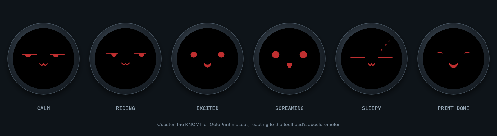
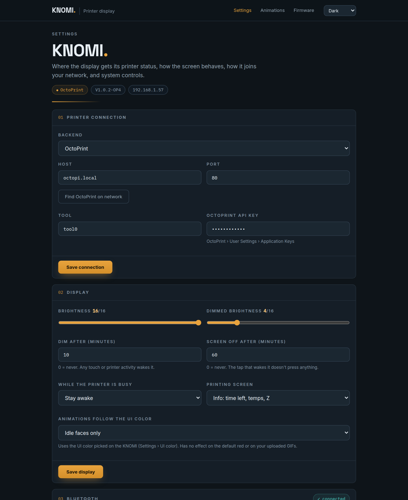
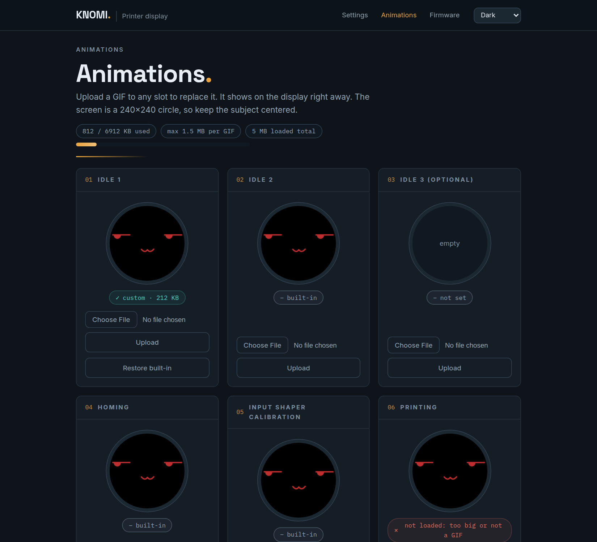

# KNOMI for OctoPrint: custom BTT KNOMI 2 firmware for OctoPrint and Klipper

**Run the BigTreeTech KNOMI / KNOMI 2 display with OctoPrint.** The stock KNOMI firmware only talks to Moonraker (Mainsail/Fluidd). This fork makes the round Voron Stealthburner display work with **OctoPrint + OctoKlipper**, and Coaster, its live mascot, comes to Moonraker setups too.

Every release has two builds of the same source:

| Build | For | How the KNOMI connects |
|---|---|---|
| **OctoPrint** (`knomiv2-octoprint-firmware.bin`) | OctoPrint, with the [OctoPrint-KNOMI plugin](https://github.com/Binnacle-Tech/OctoPrint-KNOMI) | Bluetooth to the plugin, plus its own small WiFi network that only the Pi joins. It doesn't join your WiFi. |
| **Moonraker** (`knomiv2-moonraker-firmware.bin`) | Klipper with Mainsail / Fluidd | Joins your WiFi and talks to Moonraker, like the stock firmware. No Bluetooth. |

The KNOMI refuses to install the other build by mistake, so it can't end up unable to reach the printer.

<p align="center"></p>

> [!IMPORTANT]
> **Only tested on a KNOMI 2 with OctoPrint on a Raspberry Pi 5.** The KNOMI 1 build compiles but hasn't been tested on hardware, and neither have other Pi models or hosts. Reports and PRs are welcome.

Companion plugin: **[OctoPrint-KNOMI](https://github.com/Binnacle-Tech/OctoPrint-KNOMI)** (needed by the OctoPrint build: it's how the KNOMI talks to OctoPrint).

## Meet Coaster

<p align="center"></p>

Coaster is this firmware's mascot and every face on the KNOMI. Instead of looping a GIF, it's drawn live from the KNOMI 2's accelerometer, so it rides along with your toolhead. Its eyes slosh with every move. It gets excited on fast moves and screams on hard travel, then gets used to it. It flinches at endstop hits, shivers through input shaper tests, rides the elevator during QGL and dozes off when nothing moves. It strains to heat the hotend (steam, gritted teeth, sweat), focuses on the first layer, gets sad when a print is cancelled, lonely when it loses the printer, hungry on filament runout and dozes off with the screen. It celebrates when a print finishes, and giggles when you poke it.

It also has a life of its own. It glances around, winks, yawns, hums and sneezes on its own, nods at each layer and cheers at 25, 50 and 75 %. It has feelings that last: printing and finished prints make it happy; failed prints, getting dizzy, being left off for days or heating up with nothing to print make it unhappy or mad. Every Coaster is born with its own likes and dislikes (a favorite season, long or quick prints, fast moves, being poked...), learns your printing habits, and reacts when a print breaks them. It talks (speech bubbles for milestones, the filament and whatever's on its mind), has a favorite filament, keeps an album of your prints together, and shows a clock when idle. It dresses up for the seasons too: holiday lights and snow, New Year and 4th of July fireworks, Halloween bats, spring petals, summer sunglasses and a party hat on its birthday.

Tune how it reacts on the KNOMI's **Coaster face** page, or put it on your print screen in the designer.

## Features

- **OctoPrint support.** Temps, progress, file list, print/pause/resume/cancel, preheat, extrude, home, QGL and bed mesh from the KNOMI touchscreen.
- **Bluetooth LE link to the plugin** (OctoPrint build). The plugin pushes status the moment it changes and runs the KNOMI's buttons inside OctoPrint. No API key, no polling. Pairing takes a 6-digit code from the KNOMI's screen.
- **A WiFi network just for the Pi and the KNOMI** (OctoPrint build, OP58+). From OP60 the Pi hosts a small WPA2 network on a spare WiFi interface and the KNOMI joins it, with details handed over the paired Bluetooth link. Pages, animations and firmware updates go over it fast; Bluetooth stays the control link. Your WiFi password never goes on the KNOMI.
- **All settings from OctoPrint:** the KNOMI describes its settings (`/settings.json`, see `src/settings_schema.cpp`) and the plugin builds its settings tab from that. Add a setting there and it shows up in OctoPrint with no plugin change.
- **Custom GIF animations without reflashing.** Upload a GIF to any slot from the web page (homing, probing, QGL, printing, done and more), stored on the KNOMI's flash.
- **More animation states:** input shaper calibration, PID tuning, nozzle cleaning, filament load/unload and **paused** (M600, PAUSE, MMU/ERCF).
- **Printing screen with useful info:** time left, nozzle/bed temps, Z height and layer (on OctoPrint the plugin works the layer out from the file, like the G-code viewer), file name.
- **Coaster, the mascot:** every face on the KNOMI is drawn live from the accelerometer and printer state, with quirks, lasting feelings, its own likes and dislikes, learned habits and seasonal decorations (see above).
- **One-click updates** from GitHub: from OctoPrint's KNOMI settings (OctoPrint build: the Pi downloads it and sends it over), or straight from the KNOMI's settings page (Moonraker build).
- **Self-rescue:** if new firmware crashes three times right after starting, the KNOMI goes back to the firmware it had before, no USB cable needed.
- **Log page** at `/log` for troubleshooting without a USB cable.
- **Display messages:** `M117` / `SET_DISPLAY_TEXT` show as Coaster speech bubbles.
- **Print screen designer:** a drag-and-drop editor on the KNOMI's web page. Place text with live values, progress rings, gauges, bars and animations, and rotate between up to 4 pages (e.g. a face most of the time, stats every 30 s).
- **Auto-dim and screen-off**, saved brightness, and wake on touch or printer activity.
- **Animations can follow the UI color** instead of always being red.
- **Redesigned web settings page** with dark, medium, light and high-contrast modes.
- **Dark boot and setup screens, with QR codes.** Moonraker build: scan the KNOMI's screen to join its setup network, then scan again to open the setup page. OctoPrint build: if nothing reaches it over Bluetooth for 2 minutes, it opens a network of its own and shows a QR code to join it from a phone, so it can always be reached.
- **Update check.** The settings page tells you when a newer release is out and links the right `.bin`.
- **Backup and restore** of all settings and custom animations as one file.
- **WiFi fixes** (Moonraker build):
  - joins WPA2-only, WPA3-mixed, WEP and hidden networks
  - no longer forgets your WiFi when the router is slow to come back after a power cut (it opens its setup access point alongside and keeps retrying)
- **Accelerometer bars that work** on any mounting: gravity is removed and the axes are detected automatically.

## Compatibility

| | Status |
|---|---|
| BTT KNOMI 2 (ESP32-S3) | ✅ tested |
| BTT KNOMI 1 (ESP32) | ⚠️ builds, untested on hardware |
| OctoPrint + OctoKlipper on Raspberry Pi 5 | ✅ tested |
| Other Raspberry Pi models / OctoPrint hosts | ⚠️ should work, untested |
| Moonraker build (Mainsail / Fluidd) | ⚠️ builds, untested on hardware (the Moonraker code is the same as before the split) |
| Marlin + OctoPrint | ⚠️ untested. Status and controls should work; the Klipper macro helpers don't apply |

## Install

**OctoPrint:**
1. Install the **[OctoPrint-KNOMI plugin](https://github.com/Binnacle-Tech/OctoPrint-KNOMI)** (0.14.0 or newer).
2. Flash `knomiv2-octoprint-firmware.bin` from the **[latest release](https://github.com/Binnacle-Tech/KNOMI/releases/latest)**: from stock firmware, open `http://<knomi-ip>/update` and upload it.
3. In OctoPrint, Settings › KNOMI › Bluetooth: **Find KNOMI**, **Pair**, type the code the KNOMI shows.
4. For the fast link, the Pi needs a free WiFi interface (its built-in one with the Pi on Ethernet, or a USB WiFi adapter) and a one-time permission command, which the plugin shows you.

Already on an older OctoPrint build (OP57 or earlier)? Read **[Upgrading to OP58](OCTOPRINT.md#upgrading-to-op58)** first: the KNOMI leaves your WiFi.
On OP58 or OP59? See **[Upgrading to OP60](OCTOPRINT.md#upgrading-to-op60)**: update the plugin and rerun its permission command first.

**Moonraker:** flash `knomiv2-moonraker-firmware.bin` the same way and set your Moonraker address on its settings page, as with stock.

Full setup (Klipper macros, pairing, the KNOMI network, display settings) is in **[OCTOPRINT.md](OCTOPRINT.md)**.

## Screenshots

| KNOMI settings page | Custom animations |
|---|---|
|  |  |

<p align="center"></p>

*The KNOMI screen images are mockups built from the firmware's real animations and screen layout.*

## FAQ

**Does the BTT KNOMI work with OctoPrint?**
Not with the stock firmware, which needs Moonraker. With this firmware's OctoPrint build and the plugin, yes.

**Do I still need Mainsail or Moonraker running just for the KNOMI?**
No. That's the point of this fork. The KNOMI talks to OctoPrint through the plugin, over Bluetooth.

**Why doesn't the KNOMI join my WiFi any more (OctoPrint build)?**
Since OP58 it's on a small network of its own with the Pi only (from OP60 the Pi hosts it), and Bluetooth carries the status and buttons. That keeps your WiFi password off the KNOMI, and it no longer depends on your router. The KNOMI's pages are in OctoPrint (Settings › KNOMI).

**My Pi only has WiFi. Can I still use it?**
Yes. Everything works over Bluetooth alone, just slower for pages, GIF uploads and firmware. For the fast link, put the Pi on Ethernet or add a USB WiFi adapter. The plugin never takes the WiFi interface the Pi uses for your network.

**How do I reach the KNOMI if Bluetooth stops working?**
After 2 minutes without Bluetooth, the KNOMI shows a QR code. Scan it with your phone to join the KNOMI's own network, then open `http://192.168.78.1/` (`http://192.168.77.1/` on OP58/59) for its pages, including firmware upload.

**Can I use my own GIFs on the KNOMI without rebuilding the firmware?**
Yes. In OctoPrint, Settings › KNOMI › KNOMI's web pages › Animations (or `http://<knomi-ip>/gifs` on the Moonraker build), upload a GIF to any slot. It shows up immediately.

**Can the KNOMI connect over Bluetooth instead of WiFi?**
That's how the OctoPrint build works: pair it once from OctoPrint's KNOMI settings. See [OCTOPRINT.md](OCTOPRINT.md#bluetooth).

**How do I go back to stock?**
Flash BTT's `knomi2_firmware.bin` from `/update`. Stock firmware resets the settings to defaults, so you'll re-enter WiFi through its access point.

**Is this affiliated with BIGTREETECH?**
No. It's a community fork of their open firmware source.

## Build from source

```
pio pkg install -e knomiv2
cp "lv_disp_(bugfix_backup).c" .pio/libdeps/knomiv2/lvgl/src/core/lv_disp.c   # LVGL display fix
pio run -e knomiv2
```

Environments: `knomiv2` and `knomiv1` are the OctoPrint builds, `knomiv2_moonraker` and `knomiv1_moonraker` the Moonraker builds (each needs the LVGL fix copied into its own `.pio/libdeps/<env>`). Code for one build only is marked `#if KNOMI_OCTOPRINT` (`src/knomi_flavor.h`). Each `.bin` carries `KNOMI-FLAVOR:octoprint` or `KNOMI-FLAVOR:moonraker` at byte 288, which the KNOMI checks before installing an upload.

Before releasing, run the checks (GitHub Actions runs them too and won't publish a release that fails):

```
python tools/check.py --build                       # stack per task, web routes, tables, page scripts, size
python tools/check.py --device <knomi-ip> --soak 180   # after flashing: watches it for 3 minutes
python tools/check.py --device <knomi-ip> --flash      # flash the build over WiFi, then watch it
python tools/check.py --device <knomi-ip> --perf 600   # measure fps, draw time, CPU per core/task and memory over WiFi; saves knomi-perf.csv
```

Output: `.pio/build/<env>/firmware.bin`. Flash it from `/update` (or the plugin's **Install this .bin**), or with `pio run -e knomiv2 -t upload` over USB. Use `-e knomiv1` for the KNOMI 1. The device checks (`--device`) need the KNOMI's address: the Moonraker build's on your WiFi, or `192.168.77.2` from the Pi on the OctoPrint build's network (`192.168.77.1` on OP58/59).

## Credits and license

The original firmware, UI and animations are by [BIGTREETECH](https://github.com/bigtreetech/KNOMI). The upstream repository has no license file ([bigtreetech/KNOMI#54](https://github.com/bigtreetech/KNOMI/issues/54)). The changes in this fork are provided on the same terms as the upstream code.
